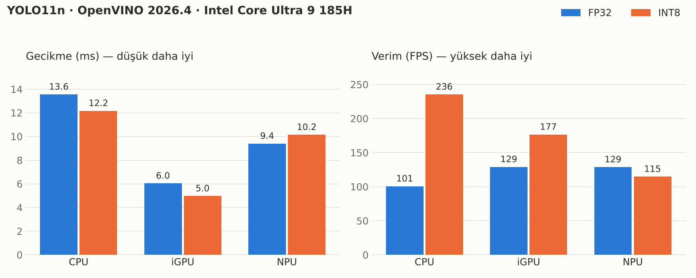

# OpenVINO YOLO Benchmark

Intel **OpenVINO** ile **YOLO11n** nesne tespit modelini bir Intel Core Ultra laptopta **CPU, iGPU ve NPU** üzerinde çalıştıran; gerçek zamanlı webcam demosu, cihaz karşılaştırması ve **FP32 → INT8 quantization** analizi içeren küçük bir proje.

*Real-time YOLO11n object detection with OpenVINO on an Intel Core Ultra laptop, plus a CPU / iGPU / NPU benchmark and an FP32 vs INT8 quantization study.*



## Öne çıkanlar

- **iGPU en düşük gecikmeyi veriyor:** kare başına ~5 ms (INT8).
- **INT8, CPU verimini 2.3 katına çıkardı:** 101 → 236 FPS.
- **NPU'da INT8 kazanç sağlamadı:** bu model ve cihaz için FP32/FP16 daha iyi çalıştı.
- **Doğruluk kaybı yok denecek kadar az:** mAP50-95 0.501 → 0.499, model ~3 kat küçüldü.

## Donanım ve yazılım

| | |
|---|---|
| İşlemci | Intel Core Ultra 9 185H |
| iGPU | Intel Graphics (dahili) |
| NPU | Intel AI Boost |
| İşletim sistemi | Windows 11 |
| Python | 3.13 |
| OpenVINO | 2026.4.1 |
| Model | YOLO11n (COCO, 80 sınıf, 640×640 giriş) |

## Kurulum

```bash
python -m venv ov-env
ov-env\Scripts\activate          # Linux/macOS: source ov-env/bin/activate
pip install -r requirements.txt
```

Kurulumu kontrol et:

```bash
python -c "import openvino as ov; print(ov.__version__); print(ov.Core().available_devices)"
```

## Modelleri oluşturma

Model dosyaları repoda yok, şu komutlarla üretilir:

```bash
# FP32 OpenVINO modeli
yolo export model=yolo11n.pt format=openvino

# INT8 modeli (NNCF ile, coco128 üzerinde kalibrasyon)
yolo export model=yolo11n.pt format=openvino int8=True data=coco128.yaml
```

Çıktı klasörleri: `yolo11n_openvino_model/` ve `yolo11n_int8_openvino_model/`.

## Kullanım

### Webcam demosu

```bash
python list_cameras.py                      # çalışan kamerayı ve index'ini bul
python yolo_webcam.py                       # varsayılan: GPU.0, kamera 0
python yolo_webcam.py --device NPU --camera 1
python yolo_webcam.py --model yolo11n_int8_openvino_model/yolo11n.xml
```

| Parametre | Açıklama | Varsayılan |
|---|---|---|
| `--model` | OpenVINO IR modeli (`.xml`) | `yolo11n_openvino_model/yolo11n.xml` |
| `--device` | `CPU`, `GPU.0`, `NPU`, `AUTO` | `GPU.0` |
| `--camera` | Kamera index'i | `0` |
| `--backend` | `MSMF` veya `DSHOW` (Windows) | `MSMF` |
| `--conf` | Güven eşiği | `0.40` |
| `--no-cache` | Model önbelleğini kapatır | kapalı |

Çıkmak için `q` veya `ESC`.

### Cihaz benchmark'ı

Kamerasız, saf model hızı ölçer:

```bash
python benchmark_devices.py --out results/benchmark_fp32.csv
python benchmark_devices.py --model yolo11n_int8_openvino_model/yolo11n.xml --out results/benchmark_int8.csv
python make_chart.py                        # assets/benchmark.png'yi yeniden çizer
```

- **Gecikme:** `LATENCY` modunda tek istekle 300 tur; ortalama, p50 ve p95.
- **Verim:** `THROUGHPUT` modunda, cihazın önerdiği sayıda paralel istekle 600 kare.
- Rastgele girdi kullanılır; YOLO'nun çıkarım süresi görüntü içeriğine bağlı değildir.

### Doğruluk ölçümü

```bash
yolo val model=yolo11n_openvino_model data=coco128.yaml
yolo val model=yolo11n_int8_openvino_model data=coco128.yaml
```

## Sonuçlar

### Hız: FP32 ve INT8

| Cihaz | Gecikme FP32 | Gecikme INT8 | Verim FP32 | Verim INT8 | Değişim (verim) |
|---|---|---|---|---|---|
| CPU | 13.56 ms | 12.17 ms | 100.7 FPS | 235.5 FPS | **×2.34** |
| iGPU (GPU.0) | 6.04 ms | **4.97 ms** | 129.1 FPS | 176.6 FPS | **×1.37** |
| NPU | 9.40 ms | 10.15 ms | 128.8 FPS | 114.8 FPS | ×0.89 |

Ham veriler: [`results/benchmark_fp32.csv`](results/benchmark_fp32.csv), [`results/benchmark_int8.csv`](results/benchmark_int8.csv)

### Doğruluk (coco128)

| Model | Precision | Recall | mAP50 | mAP50-95 | Boyut |
|---|---|---|---|---|---|
| FP32 | 0.743 | 0.555 | 0.671 | 0.501 | ~10 MB |
| INT8 | 0.708 | 0.566 | 0.672 | 0.499 | 3.3 MB |

Ham veri: [`results/accuracy_coco128.csv`](results/accuracy_coco128.csv)

## Bulgular

1. **CPU, INT8'den en çok kazanan cihaz.** Core Ultra'daki AVX-VNNI komutları INT8 çarpımlarını hızlandırıyor; paralel isteklerde verim 2.3 katına çıktı. Tek istekte kazanç az (%10), çünkü bu küçük model tek karede çekirdekleri doyurmuyor.
2. **iGPU canlı kamera için en iyi seçim.** INT8 ile gecikme %18 azaldı. Ancak ilk derleme süresi 0.5 sn'den 15.7 sn'ye çıktı. Webcam demosunda açık olan model önbelleği (`CACHE_DIR`) sayesinde sonraki açılışlarda bu süre 1 sn'nin altına iniyor.
3. **NPU'da INT8 performansı düşürdü.** NPU, FP32 modeli zaten kendi içinde FP16'ya çevirerek verimli çalıştırıyor. INT8 modelde tespit başlığı (son katman) doğruluk için FP32'de bırakıldığından tip dönüşümleri ek yük getiriyor olabilir. Sonuç olarak **"INT8 her donanımı hızlandırır" varsayımı geçerli değil; cihaz bazında ölçmek gerekiyor.**
4. **Doğruluk pratikte korunuyor.** mAP50-95'teki 0.002'lik düşüş ölçüm gürültüsü seviyesinde. Precision hafif düşüp recall hafif arttı; INT8 model biraz daha "cesur" tahmin yapıyor.
5. **Tüm cihazlar gerçek zamanlıyı rahat geçiyor.** 30 FPS'lik bir kamera kare başına 33 ms süre tanıyor; en yavaş sonuç 13.6 ms.

## Sınırlamalar

- Kalibrasyon ve doğrulama aynı küçük set (coco128) üzerinde yapıldı, doğruluk sonuçları bu yüzden iyimser olabilir. Daha güvenilir bir karşılaştırma için kalibrasyonu ayrı bir setle yapıp COCO val2017 (5000 resim) üzerinde doğrulama yapılmalı.
- Ölçümler tek bir cihazda, şarjda ve "En iyi performans" güç modunda yapıldı. Güç tüketimi ölçülmedi; NPU'nun asıl avantajı muhtemelen enerji verimliliğinde.
- OpenVINO resmi olarak yalnızca Intel donanımlarını destekler. Laptoptaki NVIDIA GPU (GPU.1) teste dahil edilmedi.

## Proje yapısı

```
├── yolo_webcam.py          # Gerçek zamanlı webcam tespiti
├── list_cameras.py         # Kamera index/backend tarayıcı
├── benchmark_devices.py    # CPU / iGPU / NPU hız ölçümü
├── make_chart.py           # Sonuç grafiğini üretir
├── results/                # Ölçüm sonuçları (CSV)
├── assets/                 # README görselleri
└── requirements.txt
```

## Lisans

Bu repodaki kodlar MIT lisansı ile paylaşılmıştır (bkz. [LICENSE](LICENSE)).

YOLO11 modeli ve `ultralytics` paketi [AGPL-3.0](https://github.com/ultralytics/ultralytics/blob/main/LICENSE) lisanslıdır. Model ağırlıkları bu repoya dahil edilmemiştir, yukarıdaki komutlarla kullanıcı tarafından indirilir.
